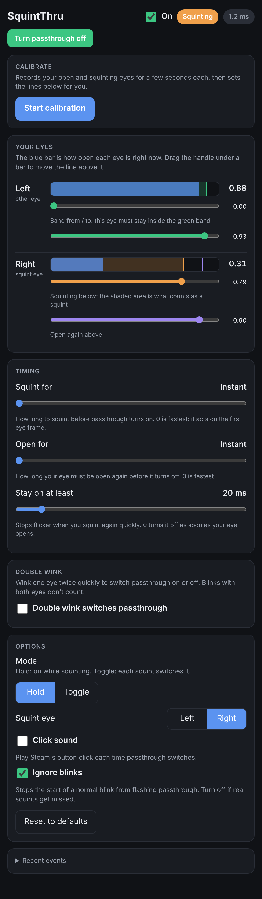
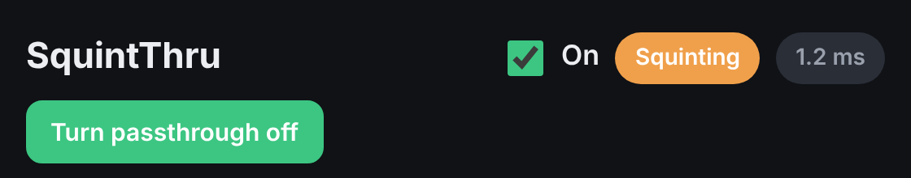
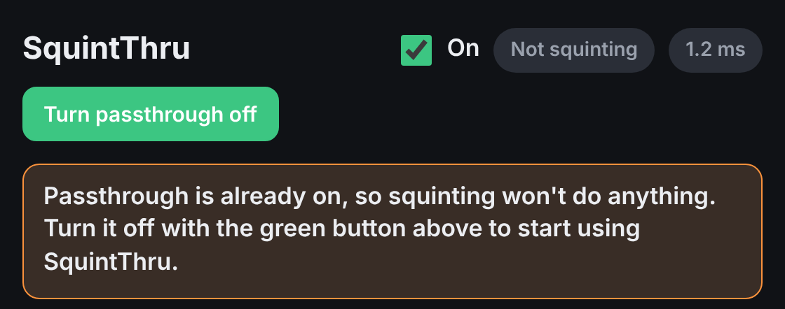
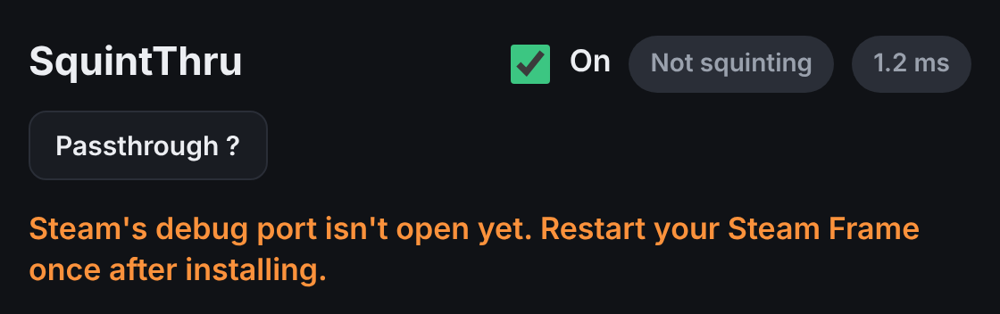
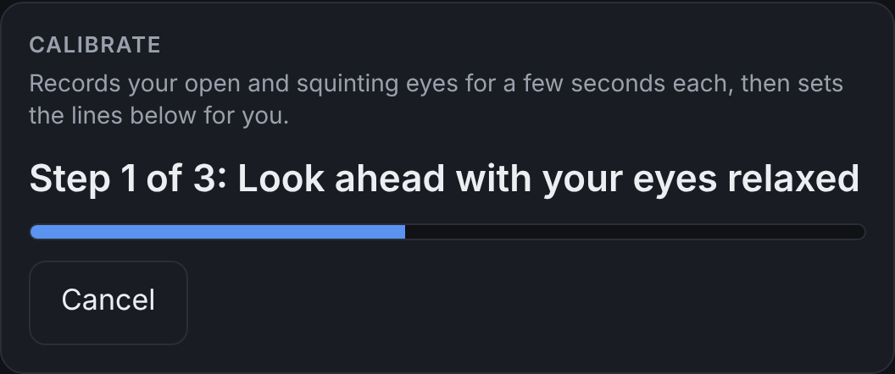
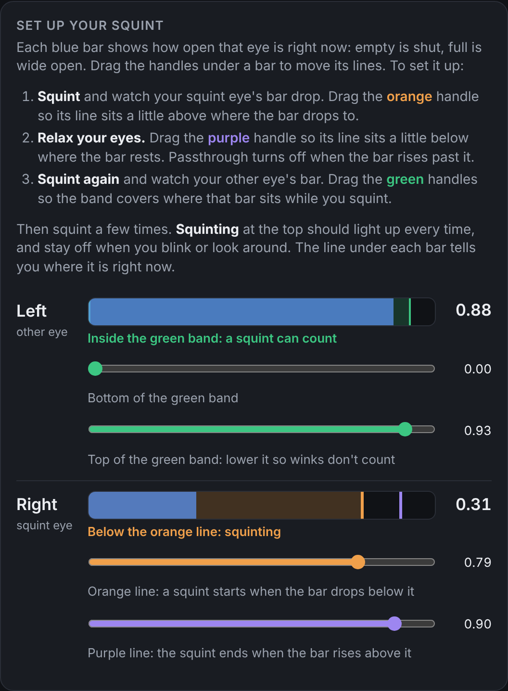
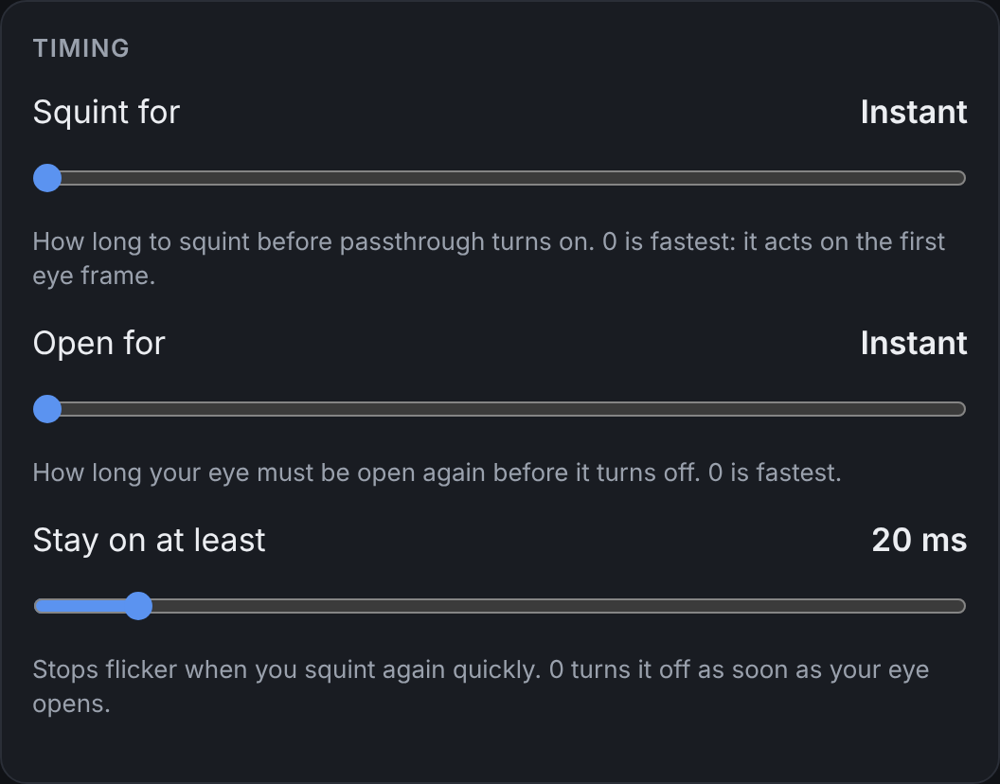
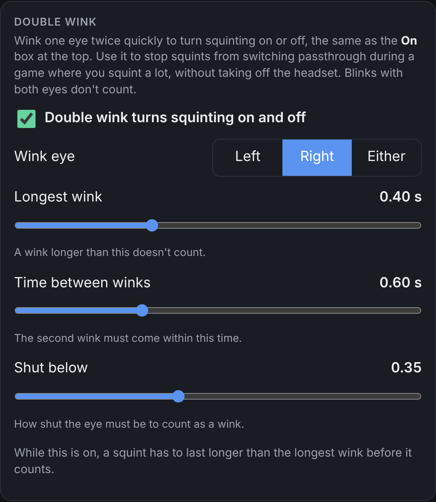
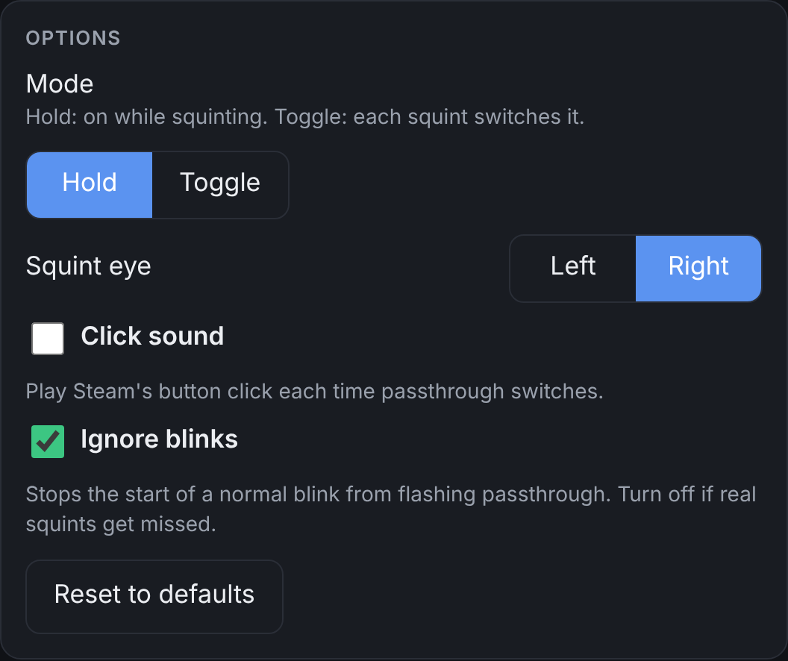

# SquintThru

Squint to see your room. SquintThru turns on Steam Frame passthrough (Room View) the moment you squint one eye, and turns it back off when you open it again. Grab your drink, check on the cat, find your controller, then get straight back to the game. It runs on the Steam Frame itself.

<p align="center"></p>

## Install

You can do the whole install while wearing your Steam Frame. It's one command, with nothing to download first.

1. **On the Frame, open this page in the browser.** That way you can copy the command below instead of typing it on the virtual keyboard.
2. **Open a terminal** on the Frame's desktop.
3. **Paste this and press Enter:**

   ```sh
   curl -fsSL https://raw.githubusercontent.com/huntergcook/SquintThru/main/install.sh | bash
   ```

4. **The SquintThru app opens when it's done.** If the installer asks you to, **restart your Steam Frame once**. That turns on the Steam setting SquintThru needs to press the Room View button, and you only do it the first time.
5. **Calibrate** in the app (see [Calibrate](#calibrate)), then try a squint.

That's it. From now on SquintThru starts by itself every time the Frame starts, with your settings loaded. You don't need to open the app again unless you want to change something.

What the installer does:

- sets SquintThru up as a background service that starts when you log in and restarts itself if anything goes wrong,
- adds **SquintThru** to your app menu and a `squintthru` command,
- turns on Steam's local debug port if it's off (see [Steam debugging](#steam-debugging)),
- needs only Python 3. No compiler, no extra packages.

**To update**, run the same command again. **To remove it**, run `squintthru uninstall`. Your settings are kept.

<details>
<summary>Prefer to type less? Install from your PC over SSH, or from a clone</summary>

If SSH is set up on your Frame, you can run the same `curl` command from your PC's terminal after `ssh` into the headset. After that, open SquintThru from the app menu on the Frame.

From a clone, run the installer in place:

```sh
git clone https://github.com/huntergcook/SquintThru.git
cd SquintThru
./install.sh
```

To update a clone: `git pull && ./install.sh`.
</details>

## Using SquintThru

**Squint your squint eye** (the right eye by default) and passthrough turns on. Open it again and passthrough turns off. Blinking with both eyes doesn't count.

Open **SquintThru** from the app menu, or run `squintthru`, whenever you want to change something. **Every change saves right away** and takes effect immediately. You can close the window at any time: squint detection runs in the background, not in the window.

### The top bar



- **On**: switches squint detection on or off.
- **Squinting / Not squinting**: whether SquintThru sees a squint right now. Use it to check your thresholds.
- **Response time** (1.2 ms here): how long the last switch took, from the eye frame that counted as a squint to Steam pressing Room View.
- **Turn passthrough on / off**: switches passthrough by hand. It turns green while passthrough is on.

If passthrough was already on before you squinted, for example because you turned it on in Steam, squinting won't do anything in Hold mode. SquintThru only turns off passthrough that it turned on itself. The app warns you when this happens:



If something is wrong, for example Steam isn't ready, a red message under the top bar says what to do.



### Calibrate



Calibration sets the lines for you in about ten seconds. It records your relaxed eyes, gives you a moment to get ready, then records you squinting. It ignores the first 0.6 s of each recording while you're still getting into position. Afterward, it picks your squint eye and places the lines. Squint a few times and check that the **Squinting** chip lights up. If it doesn't, drag the lines as described below.

### Your eyes



Each blue bar shows how open that eye is right now, from 0 (shut) to 1 (wide open). Drag the handle under a bar to move its line.

- **Squint eye**: a squint starts when this eye goes below the orange **Squinting below** line, and ends when it rises above the purple **Open again above** line. Keeping a gap between the two lines stops passthrough from flickering at the edge. Moving the orange line up, toward open, makes it trigger earlier in the squint.
- **Other eye**: it must stay inside the green band while you squint. That's how SquintThru tells a one-eye squint from a blink, where both eyes close. Lowering the top of the band stops winks from counting, because during a wink the other eye stays wide open.

### Timing



- **Squint for**: how long a squint has to last before passthrough turns on. **Instant** (0 ms) acts on the first eye frame, which is the fastest.
- **Open for**: how long your eye has to stay open before passthrough turns off. Instant is the fastest.
- **Stay on at least** (0–200 ms): once on, passthrough stays on at least this long. It stops flicker if you squint again quickly. 0 turns it off as soon as your eye opens.

Eye frames arrive about every 17 ms. At Instant, the delay you feel comes down to that one frame plus Steam's own fade.

### Double wink



Wink one eye twice quickly to switch passthrough on or off and leave it that way, for longer interruptions. Choose which eye's winks count, how short a wink must be, how close together the two winks must be, and how shut the eye must be.

While double wink is on, a squint has to last longer than the longest wink before it counts, so squints get a little slower.

### Options



- **Mode**: **Hold** keeps passthrough on while you squint. **Toggle** makes each squint switch it on or off.
- **Squint eye**: the eye you squint with. Calibration sets this for you.
- **Click sound**: plays Steam's button click each time passthrough switches. Off by default, so peeking is silent.
- **Ignore blinks**: stops the start of a normal blink from flashing passthrough. Off by default, because when you squint hard, for example during a PCVR game, your other eye can close too and the guard undoes the squint. Turn it on if blinks flash passthrough.
- **Reset to defaults**: puts every setting back to how it started.

### Commands

| Command | What it does |
|---|---|
| `squintthru` | Open the app (starts SquintThru if it isn't running) |
| `squintthru status` | Check whether it's running |
| `squintthru start` / `stop` / `restart` | Control the background service |
| `squintthru log` | Watch the log: every squint, release and problem |
| `squintthru uninstall` | Remove SquintThru |

The app opens in its own window, with no tabs or address bar, when a Chromium-based browser is installed (Chromium, Chrome, Brave or Edge, including Flatpak versions). Otherwise it opens as a page in your default browser. If that browser offers "Install app", that turns the page into its own window too.

## Speed

SquintThru acts on the first eye frame that counts as a squint, and switches Room View with one message to Steam:

- **Eye data is read in-process** from the eye server's shared memory (`eyes.py`), right as each frame arrives, about every 17 ms.
- **Squint for and Open for default to Instant.** Nothing waits for a second frame.
- **One persistent connection to Steam.** A small helper is installed in the dashboard page once. Each switch is a single round trip that checks the state and presses the button, about 1 ms, instead of opening new connections and polling to confirm.
- **The connection is warmed up at start** and kept alive, so the first squint is as fast as the rest.

What's left is Steam's own Room View fade.

Because switching is this fast, the start of a normal blink could flash passthrough. When it's on, **Ignore blinks** watches both eyes. If they close together, it's a blink and it's ignored. If passthrough turned on and the other eye shuts within 120 ms, it was a blink after all, and SquintThru turns passthrough back off.

## Settings file

Settings are saved in `~/.config/squintthru/settings.json` and loaded every time SquintThru starts. Changes made in the app take effect right away. If you edit the file by hand, run `squintthru restart` afterward. Settings from an older `settings.json` in the repo folder are picked up the first time.

| Setting | Default | Meaning |
|---|---|---|
| `enabled` | on | The **On** switch |
| `mode` | `hold` | `hold`: on while squinting. `toggle`: each squint switches it. |
| `squint_eye` | `right` | The eye that nearly shuts when you squint |
| `squint_below` | 0.79 | The squint eye must be below this... |
| `other_min` / `other_max` | 0.0 / 0.93 | ...while the other eye is in this band |
| `release_above` | 0.9 | The squint eye above this counts as open again |
| `hold` | 0 (instant) | How long a squint must last before passthrough turns on |
| `release_hold` | 0 (instant) | How long the eye must stay open before it turns off |
| `min_on` | 20 ms | Once on, passthrough stays on at least this long (0–200 ms) |
| `ignore_blinks` | off | Don't let the start of a blink count as a squint |
| `click_sound` | off | Play Steam's button click each time passthrough switches |
| `double_wink` | off | Two quick winks of `wink_eye` switch passthrough |
| `wink_eye` / `wink_below` / `wink_max` / `wink_gap` | right / 0.35 / 0.4 s / 0.6 s | Double-wink tuning |

## How it works

- `eyes.py` reads eye openness from the headset's eye server (`/dev/shm/eye-server.mmap`) using the same lock-and-request protocol as `eyestream.c`. It waits for the eye server if SteamVR isn't running and reconnects after restarts. `eyestream.c` is kept as a fallback, and the installer builds it if `gcc` is present.
- `squint.py` watches those values and decides when you're squinting. It also serves the app at http://127.0.0.1:8765, which only accepts requests from pages on the headset itself.
- `roomview.py` presses the Room View button on the SteamVR dashboard bar through Steam's CEF debug port (`127.0.0.1:8080`). Try it by hand with `python3 roomview.py` (prints `on` or `off`), or `python3 roomview.py toggle|on|off`.

### Steam debugging

Steam opens its debug port on `127.0.0.1:8080` when the file `~/.local/share/Steam/.cef-enable-remote-debugging` exists, or when Steam is started with `-cef-enable-debugging`. The installer creates the file, which is why you restart the Frame once. Check it with `curl -s http://127.0.0.1:8080/json`. The port only listens on the headset itself, but any program running there can use it to control Steam's interface. To turn it off, delete the file and restart.

### The click sound

Steam plays its button-click sound after every dashboard action. With **Click sound** off, SquintThru cancels it:

1. Clicking the Room View button queues the nav sound on a 1 ms timer, so there's a short window to cancel it.
2. Right after `button.click()`, the page helper calls `SuppressImminentNavSound()` on Steam's nav sound controller, which cancels the queued sound.
3. That controller lives in a webpack module in the main Steam UI window (the bar overlay's `opener`). Webpack module ids change between Steam builds, so the helper doesn't use a fixed id. It pushes a dummy chunk into `webpackChunksteamui` to get webpack's `require`, then searches every module's source for `SuppressImminentNavSound(){`. It caches the controller it finds, so the search only runs once per Steam session.
4. All of this is wrapped in `try/catch`. If a Steam update breaks it, switching still works and you just hear the click again.

## Troubleshooting

Check the red message in the app, or run `squintthru log`.

- **"Steam's debug port isn't open yet"**: restart your Steam Frame once after installing. See [Steam debugging](#steam-debugging).
- **"SteamVR dashboard bar not found"**: start SteamVR. SquintThru keeps retrying.
- **"waiting for eye tracking"**: eye tracking isn't running yet. SquintThru connects as soon as it is.
- **Squinting does nothing**: if the app shows the "Passthrough is already on" warning, turn passthrough off with the green button. If the log says "that was a blink; undoing", turn off **Ignore blinks**. Otherwise, watch the **Squinting** chip while you squint and drag the lines in **Your eyes** until it lights up.
- **Passthrough flashes when you blink**: turn on **Ignore blinks**, or raise the bottom of the green band on your other eye.
- **The app opens in a browser tab, not its own window**: install a Chromium-based browser, such as Chromium from Flatpak.
