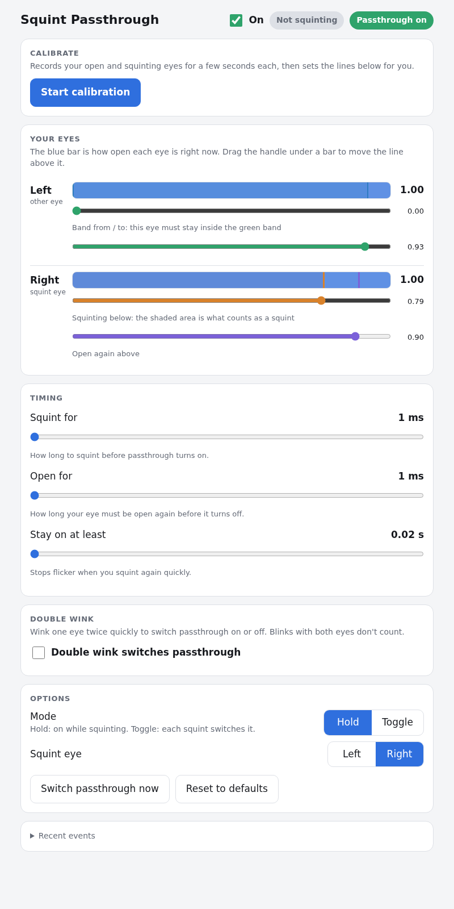

# SquintThru

Squint to see your room. SquintThru turns on Steam Frame passthrough (Room View) the moment you squint, and turns it back off when you open your eye again. It runs on the Steam Frame itself.



## Install

```sh
git clone https://github.com/huntergcook/SquintThru.git
cd SquintThru
./install.sh
```

That's it. The installer:

- sets SquintThru up as a background service that starts by itself when you log in and restarts if anything goes wrong,
- adds **SquintThru** to your app menu, which opens the settings app in its own window,
- adds a `squintthru` command,
- turns on Steam's local debug port if it's off (SquintThru uses it to press the Room View button). If it says so, **restart Steam once**.

You only need Python 3. No compiler, no extra packages.

To update: `git pull && ./install.sh`. To remove: `./install.sh --uninstall` (your settings are kept).

## Using it

Open **SquintThru** from the app menu, or run `squintthru`. The app shows your eyes live, and the chip at the top shows how fast the last switch was. Changes save right away.

**Calibrate** records your relaxed and squinting eyes and sets the lines for you. It now skips the first 0.6 s of each recording, while you're still getting into the squint, which was what threw it off before. Check the lines afterward and drag them if needed.

| Command | What it does |
|---|---|
| `squintthru` | Open the app window (starts the service if needed) |
| `squintthru status` | Is it running? |
| `squintthru start` / `stop` / `restart` | Control the service |
| `squintthru log` | Follow the log: every squint, release and problem |
| `squintthru uninstall` | Remove it |

The window opens as a plain app window when a Chromium-based browser (Chromium, Chrome, Brave, Edge, including Flatpak versions) is installed. Otherwise it opens in your default browser, where "Install app" turns it into a window.

## Speed

SquintThru acts on the first eye frame that counts as a squint, and switches Room View with a single message to Steam:

- **Eye data is read in-process** from the eye server's shared memory (`eyes.py`), right as each frame arrives (about every 17 ms).
- **Squint for / Open for default to Instant (0 ms).** Nothing waits for a second frame.
- **One persistent connection to Steam.** A small helper is installed in the dashboard page once. Each change is a single round trip that checks the state and clicks, about 1 ms, instead of opening fresh connections and polling for confirmation.
- **The connection is warmed up at start** and kept alive, so the first squint is as fast as the rest.

What's left is Steam's own Room View transition. To trigger even earlier in the squint, move the orange **Squinting below** line on your squint eye up (toward open). Calibration now places it 60% of the way from your squint toward open.

Because switching is now this fast, a normal blink could flash passthrough. **Ignore blinks** (on by default) tells a blink from a squint by checking whether both eyes close together. If it ever misses a real squint, turn it off in the app.

## Settings

Settings are saved in `~/.config/squintthru/settings.json`. Settings from an older `settings.json` in the repo folder are picked up the first time. **Reset to defaults** deletes the file.

| Setting | Default | Meaning |
|---|---|---|
| `mode` | `hold` | `hold`: on while squinting. `toggle`: each squint flips it. |
| `squint_eye` | `right` | The eye that nearly shuts when you squint |
| `squint_below` | 0.79 | The squint eye must be below this... |
| `other_min` / `other_max` | 0.0 / 0.93 | ...while the other eye is in this band |
| `release_above` | 0.9 | The squint eye above this counts as open again |
| `hold` | 0 (instant) | How long a squint must last before passthrough turns on |
| `release_hold` | 0 (instant) | How long the eye must stay open before it turns off |
| `min_on` | 20 ms | Once on, passthrough stays on at least this long |
| `ignore_blinks` | on | Don't let the start of a blink count as a squint |
| `click_sound` | off | Play Steam's button click each time passthrough switches |
| `double_wink` | off | Two quick winks of `wink_eye` toggle passthrough |
| `wink_eye` / `wink_below` / `wink_max` / `wink_gap` | right / 0.35 / 0.4 s / 0.6 s | Double-wink tuning |

With double wink on, a squint has to last longer than `wink_max` before it counts, so it's slower.

## How it works

- `eyes.py` reads eye openness from the headset's eye server (`/dev/shm/eye-server.mmap`) using the same lock-and-request protocol as `eyestream.c`. It waits for the eye server if SteamVR isn't running and reconnects after restarts. `eyestream.c` is kept as a fallback; the installer builds it if `gcc` is present.
- `squint.py` watches those values. When your squint eye drops below a threshold and the other eye stays in its band, it turns Room View on. It also serves the app page at http://127.0.0.1:8765, which only accepts requests from this machine's own pages.
- `roomview.py` presses the Room View button on the SteamVR dashboard bar through Steam's CEF debug port (`127.0.0.1:8080`). Try it by hand with `python3 roomview.py` (prints `on` or `off`), or `python3 roomview.py toggle|on|off`.

### Steam debugging

Steam opens its debug port on `127.0.0.1:8080` when the file `~/.local/share/Steam/.cef-enable-remote-debugging` exists (the installer creates it), or when Steam is started with `-cef-enable-debugging`. Check it with `curl -s http://127.0.0.1:8080/json`. The port only listens on the headset itself, but any program running there can use it to control Steam's UI. To turn it off, delete the file and restart Steam.

### The click sound

Steam plays its button-click sound after every dashboard action. With **Click sound** off, SquintThru cancels it:

1. Clicking the Room View button queues the nav sound on a 1 ms timer, so there's a short window to cancel it.
2. Right after `button.click()`, the page helper calls `SuppressImminentNavSound()` on Steam's nav sound controller, which cancels the queued sound.
3. That controller lives in a webpack module in the main Steam UI window (the bar overlay's `opener`). Webpack module ids change between Steam builds, so the helper doesn't use a fixed id. It pushes a dummy chunk into `webpackChunksteamui` to get webpack's `require`, then searches every module's source for `SuppressImminentNavSound(){`. It caches the controller it finds, so the search only runs once per Steam session.
4. All of this is wrapped in `try/catch`. If a Steam update breaks it, switching still works and you just hear the click again.

## Troubleshooting

Run `squintthru log`, or check the red message in the app.

- **"Steam debug port 8080 isn't open"**: restart Steam after installing, or see [Steam debugging](#steam-debugging).
- **"SteamVR dashboard bar not found"**: start SteamVR. SquintThru keeps retrying.
- **"waiting for eye tracking"**: eye tracking isn't running yet. SquintThru connects as soon as it is.
- **Squinting does nothing**: in Hold mode, SquintThru only turns off passthrough it turned on itself, so if passthrough was already on, squints are ignored. The app shows a warning when this happens. Turn passthrough off with the button at the top.
- **Passthrough flashes when you blink**: make sure **Ignore blinks** is on, or raise **Band from** on your other eye.
